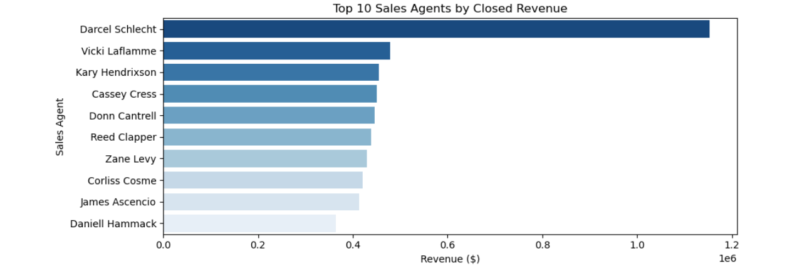

# 💼 Maven B2B CRM Sales Pipeline Analytics (SQL & Python)

An enterprise sales analytics project analyzing 4 relational CRM tables to evaluate conversion funnels, product win/loss rates, and regional sales representative performance using advanced SQL.

## 📌 Executive Summary
* **Sales Pipeline Health:** Analyzed closed-won vs. closed-lost opportunities across all product lines.
* **Rep Leaderboard:** Evaluated sales agent volume and gross closed revenue using SQL window functions (`DENSE_RANK`).
* **Relational Data Modeling:** Modeled multiple entities (`accounts`, `products`, `sales_pipeline`, `sales_teams`) inside an SQL database.

---

## 🛠️ Tech Stack
* **Database & Querying:** SQLite / MySQL, Advanced SQL (`GROUP BY`, `CASE WHEN`, `DENSE_RANK()`)
* **Data Processing & Viz:** Python, Pandas, Matplotlib, Seaborn
* **Environment:** Anaconda / Jupyter Notebook, Git

---

## 📊 Key Results & Insights

### Top 10 Sales Agents by Closed Revenue

---

## 💡 Key Business Recommendations
1. **Focus on High-Margin Products:** Certain product series demonstrate significantly higher win rates; prioritize marketing and sales outreach on these lines.
2. **Standardize Sales Playbooks:** Performance variation between top-ranked and bottom-ranked reps suggests pairing underperforming reps with top closers for mentoring.
